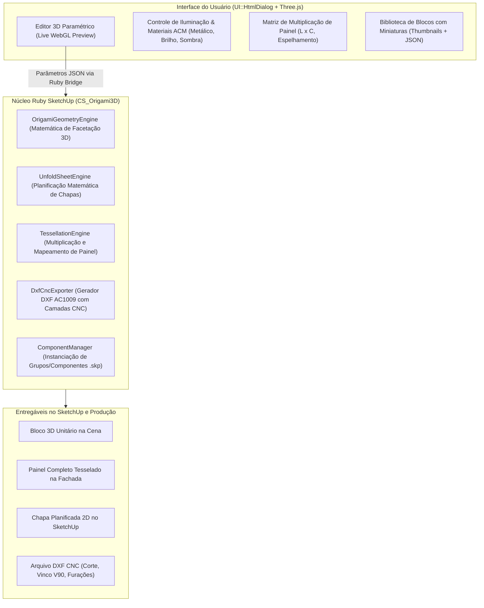

# Especificação Técnica — CS_Origami3D (Volumetria Arquitetônica em ACM)

O plugin **`CS_Origami3D`** é uma extensão autônoma para Trimble SketchUp desenvolvida especialmente para engenharia de fachadas e design de interiores em ACM (Material Composto de Alumínio) com superfícies facetadas e origami modular.

---

## 1. Arquitetura do Sistema



---

## 2. Módulos e Funcionalidades

### 2.1. Calculadora e Motor de Geometria 3D (`OrigamiGeometryEngine`)
- **Presets Paramétricos Parametrizados**:
  1. **Diamante Facetado / Piramidal**: Vértice central projetado (positivo ou negativo) com 4 a 8 facetas triangulares perimetrais.
  2. **Yoshimura / Chevron (Espinha de Peixe)**: Dobras alternadas em zigue-zague com cristas e vales contínuos.
  3. **Prisma Triangular / Split Diagonal**: Divisão angular em duas ou quatro facetas inclinadas assimétricas.
  4. **Malha Triangular Livre (Grid Paramétrico)**: Malha com vértices ajustáveis em altura $Z$.
- **Cálculo Automático**:
  - Largura ($L$), Altura ($H$) e Profundidade/Projeção ($Z$).
  - Ângulos diédricos entre facetas para usinagem de fresa em V.
  - Verificação de não-autointerseção e limites físicos de dobra do ACM.

### 2.2. Visualizador WebGL ao Vivo (Three.js no `UI::HtmlDialog`)
- **Renderização PBR de ACM**: Simulação de acabamentos metálicos (Silver, Champagne, Bronze, Black, Glossy Red, etc.).
- **Estudo de Luz e Sombra**: Luz direcional orbitável para testar como o relevo das facetas reage à luz natural do sol ao longo do dia.
- **Visualização de Vincos**: Destaque em linhas de montanha (vermelho) e vale (azul).

### 2.3. Planificação Matemática de Chapas (`UnfoldSheetEngine`)
- **Desdobramento 3D $\to$ 2D**: Planifica as facetas tridimensionais preservando a geometria plana exata de corte.
- **Abas Perimetrais de Fixação (Flanges)**:
  - Adição automática de abas de montagem de $25$ a $50\text{ mm}$ ao redor de todo o perímetro.
  - Alívios de canto e chanfros de $45^\circ$ nas extremidades para evitar colisão durante a dobra a $90^\circ$.
  - Furação paramétrica opcional nas abas para rebites de fixação estrutural.
- **Facetas Perfuradas**: Criação de malha de furos decorativos/acústicos em facetas selecionadas.

### 2.4. Exportador DXF para CNC Router (`DxfCncExporter`)
Gera arquivos padrão **AutoCAD DXF R12 / AC1009** com separação estrita por cores e camadas CAM:
- `CAMADA_CORTE` (Corte Passante Perimetral do ACM).
- `CAMADA_VINCO_V90` (Usinagem em V para dobra a $90^\circ$ no verso da chapa).
- `CAMADA_VINCO_V135` (Usinagem em V para ângulos agudos/obtusos específicos).
- `CAMADA_FUROS` (Furações de alívio, rebite e padrões perfurados).

### 2.5. Multiplicador de Painéis (`TessellationEngine`)
- Matriz de repetição (Linhas $\times$ Colunas).
- Opções de espelhamento e rotação alternada ($0^\circ, 90^\circ, 180^\circ$) para formação de padrões caleidoscópicos e contínuos.
- Dimensionamento tanto por número de módulos quanto por preenchimento de dimensões totais de fachada ($L_{\text{total}} \times H_{\text{total}}$).

### 2.6. Biblioteca de Modelos (`BlockLibrary`)
- Catálogo interno com miniaturas geradas automaticamente.
- Salvamento e carregamento de configurações em formato JSON.
- Exportação e importação de componentes nativos `.skp`.

---

## 3. Estrutura de Arquivos da Extensão

```text
sketchup-plugin/
└── CS_Origami3D/
    ├── CS_Origami3D.rb                # Registro e metadados da extensão SketchUp
    └── CS_Origami3D/
        ├── main.rb                    # Inicialização de toolbar, menus e comandos
        ├── lib/
        │   ├── geometry_engine.rb     # Matemática vetorial e geração de facetas 3D
        │   ├── unfold_engine.rb       # Desdobramento 2D e cálculo de abas/vincos
        │   ├── tessellation_engine.rb # Multiplicação e espelhamento de painéis
        │   ├── dxf_exporter.rb        # Gerador nativo de DXF CNC AC1009
        │   └── library_manager.rb     # Gerenciamento de blocos salvos e JSON
        ├── ui/
        │   ├── dialog.html            # Interface de criação e estúdio
        │   ├── dialog.css             # Estilos modernos para a UI
        │   ├── dialog.js              # Controlador e ponte JS-Ruby
        │   └── three_viewer.js        # Viewport WebGL 3D em Three.js
        └── presets/                   # Modelos padrão salvos (Diamante, Yoshimura, etc.)
```
